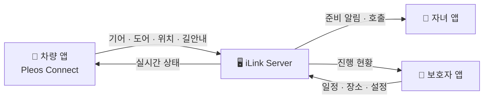

# iLink

**차가 멈춘 순간, 아이를 부릅니다** 
학원 하원 픽업을 차량과 휴대폰이 함께 챙기는 서비스

 

  

왼쪽부터 차량 디스플레이(Pleos Connect), 자녀 폰(Android), 보호자 폰(iOS)

## 왜 만들었나

학원이 끝나는 시간, 정문 앞은 늘 복잡합니다. 아이는 밖으로 나와 차를 찾고, 보호자는 운전 중에 전화와 메시지로 아이를 부릅니다.

**iLink는 차가 만나는 곳에 실제로 멈춘 걸 확인한 뒤에 아이를 부릅니다.** 그 전까지 아이는 건물 안에서 기다리고, 나갈 때는 지도로 차 위치를 봅니다. 보호자는 화면을 거의 만지지 않고 운전에 집중합니다.

## 이렇게 동작해요

| | 순간 | iLink가 하는 일 |
|:-:|---|---|
| 🚗 | **출발** | 차량 앱이 정차 지점으로 길안내를 시작하고, 자녀 화면에 차 위치와 도착 예정 시각을 보여 줍니다 |
| 🏫 | **도착 3분 전** | 정차 예상 시각을 거꾸로 계산해 아이에게 실내 준비 알림을 보냅니다 |
| 🅿️ | **정차** | 기어가 P로 바뀌고 만남 장소에 멈춘 걸 확인하면 그때 아이를 부릅니다 |
| 📍 | **못 세울 때** | ‘여기로 부르기’ 한 번으로 지금 멈춘 곳으로 장소를 바꾸고 아이를 부릅니다 |
| 🛡️ | **다시 출발하면** | 아이가 나오기 전에 차가 움직이면 호출을 자동으로 거두고 실내 대기를 안내합니다 |
| 🚪 | **탑승** | 뒷문이 열렸다 닫히면 탑승으로 보고 픽업을 마칩니다 |

  

차량 앱: 출발부터 탑승 완료까지 (빨리 감기)

## 화면

<table>
  <tr>
    <td align="center"> 보호자 · 픽업 장소</td>
    <td align="center"> 보호자 · 실시간 현황</td>
    <td align="center"> 자녀 · 준비 알림</td>
    <td align="center"> 자녀 · 만나러 가기</td>
  </tr>
</table>

## 저장소

<table>
  <tr>
    <th>저장소</th>
    <th>내용</th>
    <th>기술</th>
  </tr>
  <tr>
    <td><a href="https://github.com/Hyundai-Motor-Competition/iLink-Vehicle"><b>🚗 iLink-Vehicle</b></a></td>
    <td>Pleos Connect 차량 앱 정차 · 도어 신호, 길안내, 음성 안내, 주행 중 화면 제한</td>
    <td>Kotlin · Jetpack Compose Pleos Connect SDK</td>
  </tr>
  <tr>
    <td><a href="https://github.com/Hyundai-Motor-Competition/iLink-Client"><b>📱 iLink-Client</b></a></td>
    <td>보호자 · 자녀 모바일 앱 초기 설정, 일정 · 장소, 실시간 현황, 잠금화면 Live Activity</td>
    <td>React Native · TypeScript FCM</td>
  </tr>
  <tr>
    <td><a href="https://github.com/Hyundai-Motor-Competition/iLink-server"><b>🖥️ iLink-server</b></a></td>
    <td>공용 백엔드 호출 조건 판정, 자동 철회, 알림, 장소 추천, 실시간 상태</td>
    <td>Java 21 · Spring Boot 4 PostgreSQL + PostGIS</td>
  </tr>
</table>

## 구조

## 안전과 개인정보

- 판단이 필요한 조작은 **정차 중에만**. 주행 중에는 큰 글씨 핵심 정보와 ‘합류 안내 보류’ 한 번만 허용합니다.
- 아이 위치는 **픽업 진행 중, 보호자 · 자녀가 동의한 경우에만** 쓰고, 픽업이 끝나면 자동으로 멈춥니다.
- 신호가 끊기거나 정차에 실패하면 호출을 거두고 아이에게 실내 대기를 안내합니다.

 

2026 Hyundai Motor Competition · Team iLink

