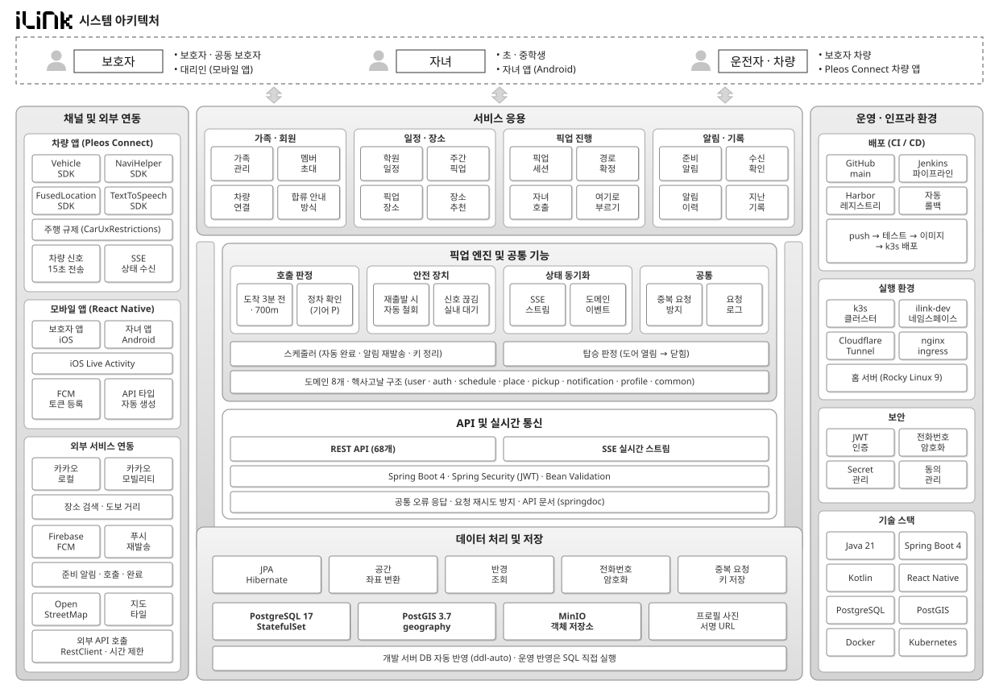

## iLink

학원 하원 픽업 서비스입니다.
보호자 차량의 Pleos Connect 앱, 보호자 · 자녀 모바일 앱, 서버로 구성되어 있습니다.

- [iLink-Vehicle](https://github.com/Hyundai-Motor-Competition/iLink-Vehicle) — 차량 앱 (Kotlin, Pleos Connect)
- [iLink-Client](https://github.com/Hyundai-Motor-Competition/iLink-Client) — 보호자 · 자녀 앱 (React Native)
- [iLink-server](https://github.com/Hyundai-Motor-Competition/iLink-server) — 서버 (Spring Boot)

### 시스템 아키텍처

2026 Hyundai Motor Competition 참가팀 iLink
