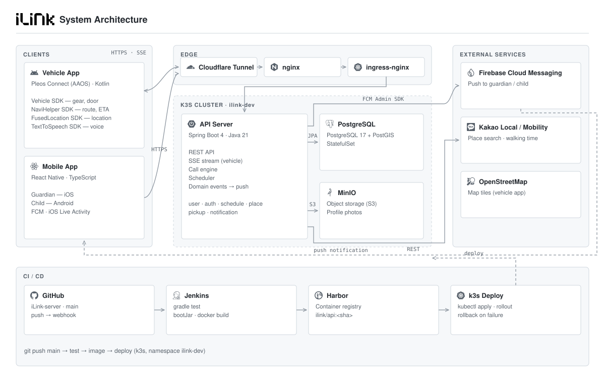

## 차가 멈춘 순간, 아이를 부릅니다

iLink는 학원 하원 픽업을 돕는 서비스입니다.
차량 앱이 정차를 확인한 뒤에 아이를 부르고, 그 전까지 아이는 건물 안에서 기다립니다.
보호자는 운전에 집중하고, 아이는 차가 어디에 섰는지 지도로 확인합니다.

**Repositories**.
[iLink-Vehicle](https://github.com/Hyundai-Motor-Competition/iLink-Vehicle) — Pleos Connect 차량 앱 (Kotlin),
[iLink-Client](https://github.com/Hyundai-Motor-Competition/iLink-Client) — 보호자 · 자녀 모바일 앱 (React Native),
[iLink-server](https://github.com/Hyundai-Motor-Competition/iLink-server) — 공용 백엔드 (Spring Boot)

**About this GitHub org**.
2026 Hyundai Motor Competition에 참가한 iLink 팀의 조직입니다.
